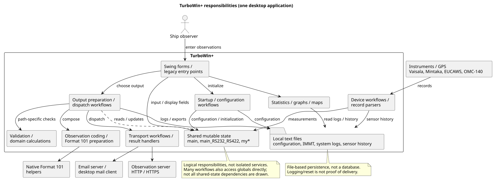

# Building Block View

TurboWin+ is one Swing desktop application. Manual observations and connected instruments feed
the current observation state; validation, coding, logging, and output workflows use that state.
Supported interfaces include Vaisala, Mintaka, EUCAWS, OMC-140 AWS, and GPS.

## Overall system

These are logical responsibilities within the same application, not isolated modules. In
particular, the shared-state relationships are not all drawn as dependency arrows.

## Implementation map

| Responsibility | Representative entry points | Boundary and remaining coupling |
| --- | --- | --- |
| Swing forms and observation state | [main](../src/main/java/turbowin/main.java), `myposition`, `mytemp`, and the other `my*` forms | Generated components, field values, and many configuration values remain static. |
| Startup and configuration | [StartupCoordinator](../src/main/java/turbowin/StartupCoordinator.java), [ConfigurationPersistenceWorkflow](../src/main/java/turbowin/ConfigurationPersistenceWorkflow.java) | Coordinates extracted startup steps and asynchronous configuration read/write; updates the existing globals. |
| Validation and calculations | [main_support](../src/main/java/turbowin/main_support.java), [LevelTwoValidationWorkflow](../src/main/java/turbowin/LevelTwoValidationWorkflow.java), [LevelThreeValidationWorkflow](../src/main/java/turbowin/LevelThreeValidationWorkflow.java) | Named validators and calculators preserve legacy ordering, thresholds, and user confirmations. Many validators still read form state. |
| Observation coding | [ObservationComposer](../src/main/java/turbowin/ObservationComposer.java), [AwsObservationComposer](../src/main/java/turbowin/AwsObservationComposer.java), [FORMAT_101](../src/main/java/turbowin/FORMAT_101.java) | Composes FM13/AWS representations and prepares Format 101 encoding. Composition still reads shared observation values; Format 101 uses native helpers. |
| Instrument acquisition and history | [RS232_mintaka](../src/main/java/turbowin/RS232_mintaka.java), [SensorDataRecordReader](../src/main/java/turbowin/SensorDataRecordReader.java), [MintakaHistoricalRecordReader](../src/main/java/turbowin/MintakaHistoricalRecordReader.java) | Device workflows combine serial/file input, format-specific parsing, age checks, and global-state updates. Record-selection policies differ by caller. |
| Files and logs | [ConfigurationFileStore](../src/main/java/turbowin/ConfigurationFileStore.java), [ObservationFileWriter](../src/main/java/turbowin/ObservationFileWriter.java), [ImmtLogWorkflow](../src/main/java/turbowin/ImmtLogWorkflow.java) | Local text files, IMMT records, system logs, and sensor-history files; not a database or a transactional persistence layer. |
| Output and transport | [ObservationEmailManualWorkflow](../src/main/java/turbowin/ObservationEmailManualWorkflow.java), [ServerObservationOutputWorkflow](../src/main/java/turbowin/ServerObservationOutputWorkflow.java), [ObservationFileOutputWorkflow](../src/main/java/turbowin/ObservationFileOutputWorkflow.java) | Chooses output-specific validation and dispatch. Email supports desktop handoff, Jakarta SMTP, and a Python helper; server output uses HTTP/HTTPS. |
| Statistics, graphs, and maps | [ObservationStatisticsWorkflow](../src/main/java/turbowin/ObservationStatisticsWorkflow.java), [DashboardLatestObservationWorkflow](../src/main/java/turbowin/DashboardLatestObservationWorkflow.java) | Reads local logs and sensor data for existing views, with browser/resource integrations where required. |

## What the extraction changed

Legacy entry methods in `main`, `main_support`, and device classes often delegate to smaller
workflow, parser, formatter, or calculator classes. Some helpers accept explicit inputs and can
be tested without constructing a window. Other extracted classes still access static fields
directly. Extraction therefore improves responsibility boundaries without establishing complete
state isolation or a new layered architecture.

For execution order and side effects, see the [runtime view](06_runtime_view.md). For state,
threading, and file-format contracts, see [cross-cutting concepts](08_concepts.md).
