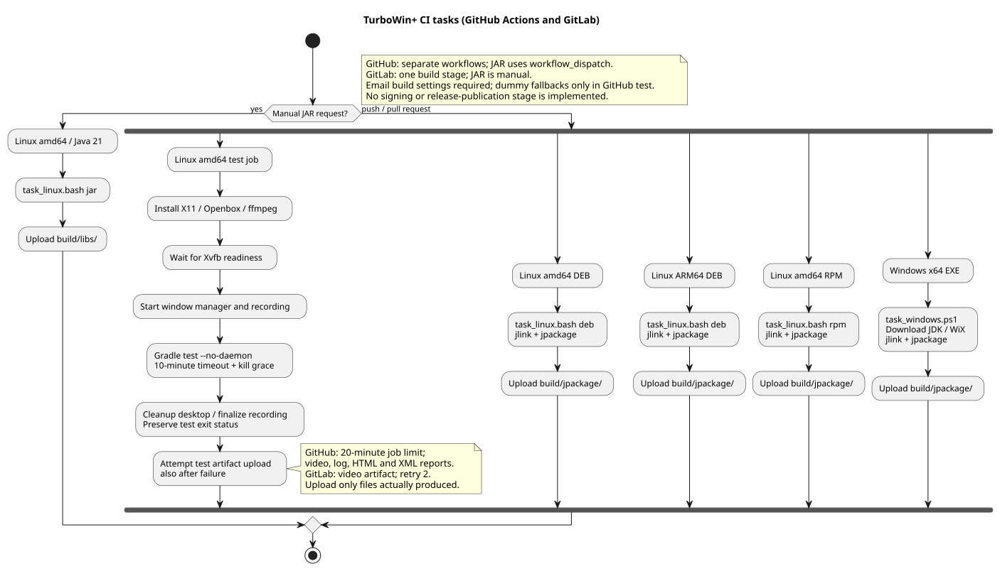

# Deployment View

TurboWin+ is installed locally on ship-based and fixed sea stations. Current packaging jobs target
Windows x64, Linux DEB on amd64/ARM64, and Linux RPM on amd64. Java portability does not guarantee
that every hardware driver or desktop integration works on every platform. Format 101 encoding
is implemented in Java and no native Format 101 helper is packaged with the application.

## Runtime and writable data

The build requires a Java 21 JDK. `jlink` creates the runtime image used by `jpackage` installers,
so those installations do not require a separately installed Java runtime. A standalone JAR is
not the same deployment: it does not bundle a runtime or all dependency JARs.

Current default writable roots from
[StartupEnvironment](../src/main/java/turbowin/StartupEnvironment.java) are:

| Platform branch | Data root |
| --- | --- |
| Windows | `C:\ProgramData\TurboWinPlus` |
| Non-Windows | `/opt/turbowinplus/data` |

Desktop startup creates `logs` (including system logs) and `amver` below that root. Installation
and user permissions must permit writing there. Tests can use the `turbowin.data.dir` system
property to redirect startup data into a temporary directory. Configuration writes also target
the data/log directories; see [persistence concepts](08_concepts.md#configuration-and-local-persistence).

The application currently starts in installed desktop ("offline") mode. This is distinct from
having no network connection: observation uploads, custom email, and external web resources still
use network services when selected.

## Build and packaging entry points

Use the Gradle wrapper and [build.gradle](../build.gradle). The generated application-version and
email-settings classes belong under `build/generated/`, not in the source tree. Compilation needs
all four non-empty build settings:

- `TURBOWIN_EMAIL_ENCRYPTION_KEY`
- `TURBOWIN_EMAIL_CHARACTER_ENCODING`
- `TURBOWIN_EMAIL_CIPHER_TRANSFORMATION`
- `TURBOWIN_EMAIL_AES_ENCRYPTION_ALGORITHM`

These are embedded by generation, not simply read as runtime environment overrides. Release
builds need the intended settings compatible with deployed encrypted email credentials. Dummy
values are for tests only; do not distribute a package built with those test values.

The platform scripts share [variables.json](../scripts/variables.json):

| Task | Entry point | Output |
| --- | --- | --- |
| JAR | `./scripts/task_linux.bash jar` | `build/libs/` |
| Full Linux tests and recording | `./scripts/task_linux.bash test` | Video/log plus Gradle HTML/XML reports |
| DEB on the runner's architecture | `./scripts/task_linux.bash deb` | `build/jpackage/` |
| RPM | `./scripts/task_linux.bash rpm` | `build/jpackage/` |
| Windows EXE | `powershell -File scripts/task_windows.ps1` | `build/jpackage/` |

The Linux script installs operating-system packages and expects an appropriate privileged
APT/microdnf environment and `JAVA_HOME`; it is intended for the CI containers, not an ordinary
unprivileged workstation command. The Windows script downloads the configured Liberica JDK and
WiX tools. Format 101 reference binaries used by compatibility tests are not production runtime
assets.

## Continuous integration

[GitHub Actions](../.github/workflows/) defines separate test and platform packaging workflows
on pushes/pull requests; the JAR workflow is manually dispatched. [.gitlab-ci.yml](../.gitlab-ci.yml)
defines equivalent task entry points in one `build` stage, with a manual JAR job. There is no
implemented signing or automatic release-publication stage in these definitions.

The shared Linux test task waits for Xvfb readiness, starts Openbox and screen recording, then runs
Gradle with `--no-daemon`. Gradle has a ten-minute timeout (with a thirty-second kill grace period).
Cleanup preserves the test exit status, stops the owned desktop processes, and finalizes the
recording on success or failure, with bounded recorder shutdown.

GitHub's test job has a twenty-minute job limit and attempts artifact upload even after failure:

- `screen_capture.webm`
- `test-run.log`
- `build/reports/tests/test/`
- `build/test-results/test/*.xml`

Files may be absent if startup fails before they are produced. Only the GitHub test workflow has
dummy fallbacks for missing email secrets; its packaging workflows still require configured
secrets. GitLab retries the test job twice and uploads the recording even on failure, but does not
currently declare all the additional report/log artifacts or the same job timeout/fallbacks.

For workstation commands and troubleshooting, see the [testing guide](contributing_and_testing.md).
Release artifacts should remain outside Git, following the [artifact policy](repository_cleanup.md).
