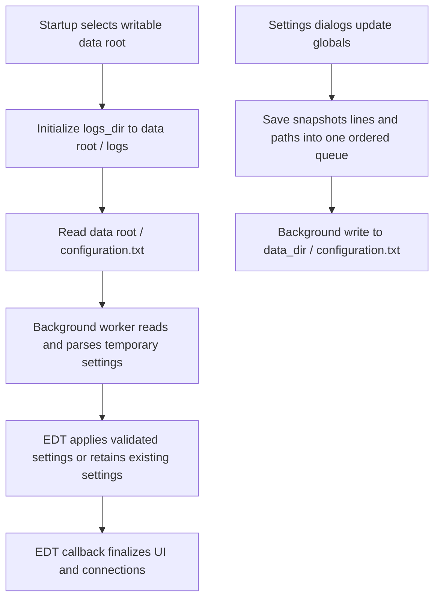

# Configuration persistence

TurboWin keeps its active settings in mutable static fields in `main`, such as `ship_name`,
`wind_source`, and serial/email/dashboard settings. `configuration.txt` stores those settings
between runs. The `configuratie_regels` array (Dutch for "configuration lines") is an intermediate
text representation, not a second independent settings model.

## What happened to muffins?

Java Web Start provided persistent local storage, commonly called "muffins", through its JNLP
persistence service. Older TurboWin comments describe saving metadata there and keeping two
`configuration.txt` copies as backups. The current installed application has no active muffin
reader or writer. Its persistence uses one text file in the data root. Historical muffin paths,
`read_muffin()` references in comments, and `MUFFIN_LINE_SEPARATOR` do not describe an active
storage mechanism. Renaming launcher markers does not restore muffin support.

## Loading and saving



`main.lees_configuratie_regels()` and `main.schrijf_configuratie_regels()` delegate through
`ConfigurationPersistenceWorkflow` to `ConfigurationReadWorkflow` and `ConfigurationWriteWorkflow`.
`ConfigurationManager` converts between globals and text lines; `ConfigurationFileStore` performs
file I/O. The same line format is used by maintenance import/export.

The data root defaults to `C:\ProgramData\TurboWinPlus` on Windows and `/opt/turbowinplus/data`
elsewhere. `-Dturbowin.data.dir=...` overrides it and disables automatic legacy migration.
Otherwise startup checks the known Windows, Debian, and versioned RPM installation
layouts before loading; see the [deployment view](07_deployment_view.md#runtime-and-writable-data).
Current startup always selects installed desktop ("offline") mode, which still permits networking.

The reader loads only `data_dir/configuration.txt`. Missing, unreadable, malformed, empty,
and unknown-only files leave existing settings and lines intact. Parsing finishes before any
settings are applied. Missing entries in a valid partial file preserve existing global values.
Diagnostics identify the file and rejection reason without exposing rejected values. If the data
directory is empty, no read or startup finalization is scheduled. Loading does not write or repair
a file. A configuration in a logs folder is never a startup fallback.

Startup initially sets `logs_dir` to `<data root>/logs`, but applying a saved logs-folder entry can
replace it. This changes operational logs, not where configuration is stored. `data_dir` is
selected by startup and cannot be changed by a configuration entry.

Automatic migration tries both legacy locations, logs first and then the installation's bin root.
It creates only `<new data root>/configuration.txt`, preserving any existing canonical file.
Installation-local logs paths are rebased to the new default; custom folders retain their location.
Explicit maintenance import applies the supplied logs-folder setting without rebasing it.

After the background read and parsing, the Swing completion callback retrieves the worker result,
applies an accepted file, and reports diagnostics. It then logs startup, cleans old system logs,
updates station identity, checks metadata, creates menus, initializes connections, and updates
menu/toolbar availability. Startup finalization also runs when the file is unusable or the
background worker fails.

Saving rebuilds the line array from globals and captures the lines and data-root destination.
Snapshot capture and submission are synchronized. One background queue preserves request order,
so an older snapshot cannot overwrite a newer one within this process. Changes to globals cannot
alter a queued save. Imports and shutdown use the same single-file save workflow. An empty data
directory is an error, even when a logs directory is available.

Each write uses a uniquely named temporary file in the destination directory, closes it, then
atomically replaces `configuration.txt`. A failed write or replacement removes the temporary file
and leaves the previous configuration in place. Filesystems that do not support atomic replacement
report a save error; there is no non-atomic fallback. Existing configuration symlinks are followed
so their targets are replaced, and existing POSIX access modes are preserved. New files retain
regular-file permissions subject to the process umask on POSIX filesystems.

Returning from the save method does not mean the file has finished saving. A failed write is
reported to standard output and displays a warning on the EDT without blocking later saves.
During shutdown, failures use the retry/cancel/exit decision dialog instead. Atomic replacement prevents partial
file contents; it does not add power-loss durability or automatic recovery of temporary files
left by a process crash.

## Saving before exit

Window close, menu Exit, and tray Exit use the same shutdown handler. After the existing exit
confirmation, it queues a final snapshot of current settings and waits for the configuration save
queue. A progress dialog prevents further UI edits while Swing continues processing events.
Saves submitted by an already-running workflow during this wait are also drained before the
completion callback. Repeated exit requests do not start additional shutdown attempts.
The progress dialog also offers Cancel exit, allowing normal use to resume if storage is slow.
Cancellation does not interrupt an in-progress file write, and its eventual completion cannot
trigger the cancelled exit.

The latest save request must save the data-root configuration before shutdown proceeds
automatically. An older failed snapshot does not block exit if the final snapshot succeeds.
Failures identify the affected configuration files and offer Retry saving, Cancel exit, or Exit
without saving. Closing that decision dialog cancels exit. Retry captures current settings again
and attempts the same file again; cancelling keeps connections and the application running and leaves
the save queue available. With no configured data directory, exit also requires a decision.

Only after successful saving or an explicit choice to exit without saving does the handler close
serial connections, remove the tray icon if needed, log shutdown, and exit. This waits for
configuration writes, not every background operation or system-log write. Forced termination,
crashes, and the duplicate-instance startup rejection do not drain the daemon save queue.

## File format

The file contains labeled text lines with a fixed 21-character prefix, including padding, a colon,
and a space. For example:

```text
ship name          : Example Ship
wind source        : estimated; true speed and true direction
```

`ConfigurationManager.fillConfigurationLines()` writes wind source at index `7`; index `2` is
the legacy call-sign label. Call-sign and masked-call-sign values are deliberately omitted from
these legacy entries and are not applied when reading them.

The array has 100 entries; the current builder assigns indices `0` through `88`. The writer skips
null/empty entries, so array positions need not survive a file round trip. The reader accepts at
most 100 physical lines. Applying settings scans all entries and matches the padded label using
substring matching, then takes the value starting at character offset 21. It does not dispatch by
array index or parse an arbitrary `key: value` syntax. Preserve the label padding when editing a
file. Recognized repeated settings are applied in file order, so the later value wins if parsing
completes. Unknown lines are ignored; malformed recognized values reject the entire candidate
before any of its settings are applied. Legacy boolean coercion and serial-code conversions remain
unchanged; validation does not impose new ranges on values that previously remained strings.

The store uses `FileReader`/`FileWriter` default character encoding and platform line endings.
Some values are parsed as integers or booleans; others remain strings. After applying settings,
the manager selects effective serial-port names and maps historical `python_email` to
`jakarta_email`. Email password fields already contain encrypted strings when handed to the
configuration builder; the file store does no encryption of its own.

## Import and export

Maintenance and station-data imports use `ConfigurationImportReader` to read up to 100 lines into
a private buffer and parse recognized values in the background. No live settings or shared lines
change while reading or parsing. A read error, malformed recognized value, or file with no
recognized settings rejects the import without applying or saving it. Diagnostics report the
failure without including rejected values. Missing settings in a valid older partial file retain
their current values, and unknown labels are ignored.

Maintenance import additionally requires the ship-name and call-sign labels in that same buffer;
it reads the source only once. The check requires the labels, not non-empty values. It does not
exclude `logs dir`. Its EDT completion callback applies a valid import, starts saving, reports
success or failure, and refreshes the maintenance display in either case. The success message
confirms that the import was applied and saving was queued; it does not wait for saving to finish.

Station-data import uses the same settings parser, so it can apply settings beyond station
metadata. It excludes `logs dir` in offline mode, captured when the import starts, and does not
require the maintenance identity labels. Its EDT completion callback applies a valid import,
starts saving, and refreshes the station form. Failure is logged without saving or refreshing the
form. An import source that is also a save destination is read and closed before saving begins.
The configuration writes remain asynchronous: refreshing either form is not proof that the file
has finished saving, and a later save error does not roll back the applied import.

Maintenance display rebuilds the array from current globals. Maintenance export writes the
current array to the chosen file without first rebuilding it, then refreshes the display. An
export therefore reflects the array available when its worker runs, which can lag unsaved global
changes. Accepted imports update the shared array on the EDT; exports and ordinary saves use that
array as described above.
