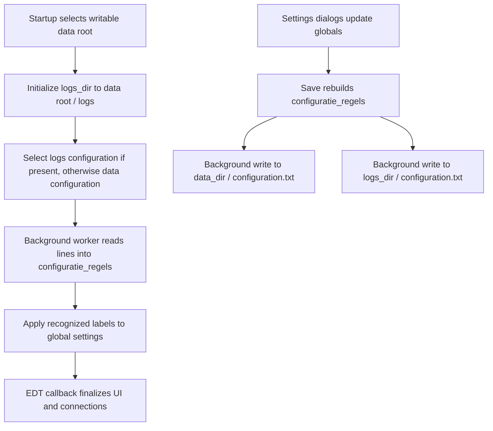

# Configuration persistence

TurboWin keeps its active settings in mutable static fields in `main`, such as `ship_name`,
`wind_source`, and serial/email/dashboard settings. `configuration.txt` stores those settings
between runs. The `configuratie_regels` array (Dutch for "configuration lines") is an intermediate
text representation, not a second independent settings model.

## What happened to muffins?

Java Web Start provided persistent local storage, commonly called "muffins", through its JNLP
persistence service. Older TurboWin comments describe saving metadata there and keeping two
`configuration.txt` copies as backups. The current installed application has no active muffin
reader or writer. Its persistence uses the two text files directly. Historical muffin paths,
`read_muffin()` references in comments, and `MUFFIN_LINE_SEPARATOR` do not describe an active
storage mechanism. Renaming launcher markers does not restore muffin support.

## Loading and saving



`main.lees_configuratie_regels()` and `main.schrijf_configuratie_regels()` delegate through
`ConfigurationPersistenceWorkflow` to `ConfigurationReadWorkflow` and `ConfigurationWriteWorkflow`.
`ConfigurationManager` converts between globals and text lines; `ConfigurationFileStore` performs
file I/O. The same line format is used by maintenance import/export.

The data root defaults to `C:\ProgramData\TurboWinPlus` on Windows and `/opt/turbowinplus/data`
elsewhere. `-Dturbowin.data.dir=...` overrides it. Before loading, startup can migrate old files
from `user.dir`; see the [deployment view](07_deployment_view.md#runtime-and-writable-data).
Current startup always selects installed desktop ("offline") mode, which still permits networking.

The reader selects an existing `configuration.txt` under `logs_dir` first, then under `data_dir`.
It does not merge the copies or compare modification dates. If neither exists, it tries the first
non-empty directory in that same order. If both directory names are empty, it schedules nothing,
including no startup finalization. An I/O failure reading the selected file does not retry the
other copy. The line array is cleared before the file is opened, so a missing file leaves an empty
array; an interrupted read can leave partial contents. Applying missing entries preserves the
current global values, which are normally field defaults on a fresh process, but may be previous
values on a theme restart. Loading does not itself write a new configuration file.

Startup initially sets `logs_dir` to `<data root>/logs`, but applying a saved `logs dir` entry can
replace it, even in offline mode. Thus the directory used to locate the startup file and the
directory used for subsequent logs/saves can differ. `data_dir` is selected by startup, not loaded
from a configuration entry.

After the background read, the Swing completion callback logs startup, cleans old system logs,
updates station identity, checks metadata, creates menus, initializes connections, and updates
menu/toolbar availability. The current callback does not call `SwingWorker.get()`: an exception
while applying malformed settings does not prevent it from attempting startup finalization.

Saving first rebuilds the line array from globals, then starts an independent worker for each
non-empty data/log directory. Each worker overwrites its file directly. Completion of the save
method does not mean the files are finished, and the two copies are not an atomic backup pair.
Data-root write errors go to standard output; log-directory write errors display a warning.
Workers share the mutable array and directory globals rather than taking an immutable snapshot.

## File format

The file contains labeled text lines with a fixed 21-character prefix, including padding, a colon,
and a space. For example:

```text
ship name          : Example Ship
wind source        : estimated; true speed and true direction
```

`ConfigurationManager.fillConfigurationLines()` writes wind source at index `7`; index `2` is
the legacy call-sign label. Call-sign and masked-call-sign values are deliberately omitted from
these legacy entries and are not applied when reading them.

The array has 100 entries; the current builder assigns indices `0` through `88`. The writer skips
null/empty entries, so array positions need not survive a file round trip. The reader accepts at
most 100 physical lines. Applying settings scans all entries and matches the padded label using
substring matching, then takes the value starting at character offset 21. It does not dispatch by
array index or parse an arbitrary `key: value` syntax. Preserve the label padding when editing a
file. Recognized repeated settings are applied in file order, so the later value wins if parsing
completes. Unknown lines are ignored; malformed recognized values can throw parsing exceptions.

The store uses `FileReader`/`FileWriter` default character encoding and platform line endings.
Some values are parsed as integers or booleans; others remain strings. After applying settings,
the manager selects effective serial-port names and maps historical `python_email` to
`jakarta_email`. Email password fields already contain encrypted strings when handed to the
configuration builder; the file store does no encryption of its own.

## Import and export

Maintenance import checks for the ship-name and call-sign labels within the first 100 lines,
then reads up to 100 lines, applies them, and starts saving the resulting globals. The check
requires the labels, not non-empty values. It does not exclude `logs dir`. Its success message
does not wait for the resulting configuration writes to finish.

Station-data import uses the same global settings parser, so it can apply settings beyond station
metadata. It excludes `logs dir` in offline mode and refreshes the station form after applying the
lines. Its caller starts saving immediately after scheduling import; that save does not wait for
the import worker and therefore is not proof that imported values reached disk.

Maintenance display rebuilds the array from current globals. Maintenance export writes the
current array to the chosen file without first rebuilding it, then refreshes the display. An
export therefore reflects the array available when its worker runs, which can lag unsaved global
changes. Import/export and ordinary saves all share that array.

These details describe the existing implementation. In particular, fallback on a missing copy,
recovery from a failed read, and completion of asynchronous saving are separate behaviors.
